  

I build machine learning experiments and practical AI tools, with interests in
language models, reinforcement learning, and generative audio.

My projects range from experimenting with neural network architectures to building
local audio workflows. I enjoy working through both the mathematical ideas and the
engineering needed to make them useful.

## Tools I work with

  

## Selected projects

| Project | What I'm exploring |
| --- | --- |
| [Audiobook Generator](https://github.com/edwardduda/audiobook_generator) | Local, multi-voice audiobook generation with PDF text preparation and speech synthesis on Apple Silicon. |
| [B-Spline Neural Networks](https://github.com/edwardduda/b-spline_neural_networks) | Comparing Transformer language models with standard MLP layers and B-spline Kolmogorov–Arnold Network layers. |
| [MoonPi](https://github.com/edwardduda/MoonPi) | Deep reinforcement learning for algorithmic trading, with a custom environment and attention-based DQN architecture. |
| [Mamba + Transformer LLM](https://github.com/edwardduda/Mamba-Transformer-LLM) | Experiments combining selective state-space models and Transformer blocks for language modeling. |

## Most-used languages

  

Based on repository code size; this chart reflects the code on GitHub, including notebooks.

## A little about me

- My academic background is in computer science, with a focus on AI and machine learning and a mathematics minor.
- I speak English and French.
- I like projects where mathematical ideas meet practical engineering.

[Connect on LinkedIn](https://www.linkedin.com/in/edwardduda/)
